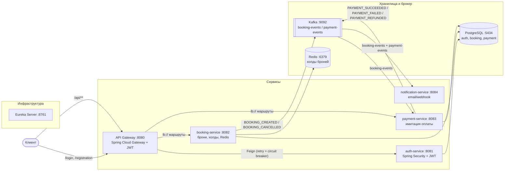

# Hotel Booking App

Микросервисное приложение для бронирования отелей: бронирование с временным холдом,
имитация оплаты через Kafka и уведомления пользователей.

## Архитектура



### Сценарий бронирования

1. Клиент регистрируется и входит через шлюз (`/registration`, `/login`) — auth-service выдаёт JWT.
2. `GET /api/rooms?checkIn=...&checkOut=...` — поиск свободных номеров (booking-service).
3. `POST /api/bookings` — создаётся бронь со статусом `PENDING`, в Redis ставится холд
   с TTL 10 минут, в Kafka публикуется `BOOKING_CREATED`.
4. payment-service потребляет событие, «проводит платёж» (имитация: задержка + вероятность успеха
   `payment.success-rate`), сохраняет результат и публикует `PAYMENT_SUCCEEDED` / `PAYMENT_FAILED`.
5. booking-service подтверждает (`CONFIRMED`) или отменяет бронь и снимает холд;
   в `booking-events` публикуется `BOOKING_CONFIRMED`.
6. notification-service рассылает уведомления по каналам: email (лог) и webhook (опционально).
7. Если платёж не пришёл за время холда, шедулер переводит бронь в `EXPIRED`.

Отмена (`POST /api/bookings/{id}/cancel`) публикует `BOOKING_CANCELLED`, payment-service
возвращает успешный платёж (`PAYMENT_REFUNDED`).

## Стек

- Java 21, Spring Boot 4, Spring Cloud (Gateway server-webmvc, OpenFeign, Eureka)
- PostgreSQL + Flyway, JDBI (без JPA), Redis
- Apache Kafka (KRaft, без Zookeeper)
- Resilience4j: circuit breaker + retry на вызовах auth-service
- Testcontainers: интеграционные тесты booking/payment (Postgres + Kafka + Redis)
- Actuator + Prometheus + Grafana, Kafka UI

## Запуск

Требуется JDK 21 и Docker.

```bash
./build.sh                 # собрать bootJar всех сервисов
docker compose up --build  # поднять инфраструктуру и сервисы
```

> `infra/init.sql` создаёт базы `booking_db` и `payment_db` при первом старте Postgres.
> Если том `postgres_data` остался от старой версии проекта, выполните `docker compose down -v`.

После старта:

| Сервис | Адрес |
|---|---|
| Gateway (входная точка) | http://localhost:8080 |
| auth-service (Swagger) | http://localhost:8081/swagger-ui.html |
| booking-service (Swagger) | http://localhost:8082/swagger-ui.html |
| Eureka | http://localhost:8761 |
| Kafka UI | http://localhost:8085 |
| Prometheus | http://localhost:9090 |
| Grafana (admin/admin) | http://localhost:3000 |

### Пример

```bash
# регистрация и вход
TOKEN=$(curl -s -X POST localhost:8080/registration \
  -H 'Content-Type: application/json' \
  -d '{"name": "ivan_ivanov", "password": "Str0ng@Pass"}' | jq -r .accessToken)

# свободные номера
curl -s "localhost:8080/api/rooms?checkIn=2026-12-01&checkOut=2026-12-05" \
  -H "Authorization: Bearer $TOKEN"

# создать бронирование (roomId из ответа выше)
curl -s -X POST localhost:8080/api/bookings \
  -H "Authorization: Bearer $TOKEN" -H 'Content-Type: application/json' \
  -d '{"roomId": 1, "checkIn": "2026-12-01", "checkOut": "2026-12-05"}'

# мои брони (после обработки платежа статус станет CONFIRMED или CANCELLED)
curl -s localhost:8080/api/bookings -H "Authorization: Bearer $TOKEN"
```

Уведомления видно в логах: `docker compose logs -f notification-service`.

## Тесты

```bash
cd booking-service  && ./gradlew test   # Testcontainers: Postgres + Kafka + Redis
cd payment-service  && ./gradlew test   # Testcontainers: Postgres + Kafka
cd notification-service && ./gradlew test
cd gateway && ./gradlew test            # unit: JWT-фильтр
```

## Структура

Каждый сервис — независимый Gradle-проект (свой `gradlew`), собирается `./build.sh` или
по отдельности `./gradlew bootJar` в каталоге сервиса.

| Сервис | Ответственность |
|---|---|
| `eureka-server` | discovery для `lb://`-маршрутов шлюза |
| `auth-service` | регистрация/вход, выдача JWT, пользователи |
| `gateway` | роутинг `/api/**`, проверка JWT, прокидывание `X-User-Name`/`X-User-Role`, Feign к auth-service с retry + circuit breaker |
| `booking-service` | номера, брони, exclusion-ограничение против двойного бронирования, Redis-холды, шедулер истечения |
| `payment-service` | потребляет `booking-events`, имитирует оплату, публикует `payment-events`, возвраты |
| `notification-service` | потребляет оба топика, каналы email (лог) и webhook (`NOTIFICATION_WEBHOOK_URL`) |

### Почему сервисы доверяют `X-User-*`

JWT проверяется один раз на шлюзе; сервисы за шлюзом читают только заголовки,
которые шлюз перекрывает поверх клиентских. Порты сервисов не нужно открывать наружу
кроме как для разработки — они находятся во внутренней docker-сети.

## Конфигурация (переменные окружения)

| Переменная | По умолчанию | Описание |
|---|---|---|
| `JWT_SECRET` | dev-секрет | общий секрет подписи JWT (auth + gateway) |
| `PAYMENT_SUCCESS_RATE` | 0.9 | доля успешных «платежей» |
| `NOTIFICATION_WEBHOOK_URL` | пусто | webhook-адрес канала уведомлений |
| `KAFKA_BOOTSTRAP_SERVERS` | localhost:9092 | адрес Kafka |
